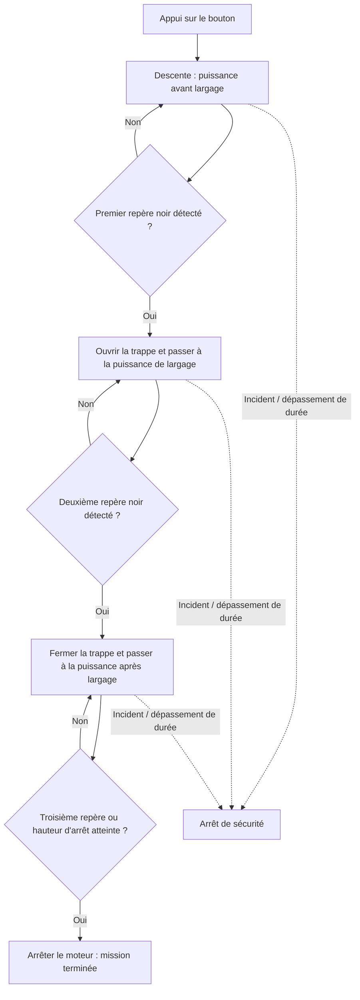

# R.A.L.F. — Intelligence embarquée à trois repères

Ce document décrit le **patch à trois scotchs et trois commandes moteur**, basé sur le commit GitHub `09d18173` (`update small bugs`). Il remplace la description précédente, limitée à START et END. Le code de référence est `intelligence.py` du patch, appelé depuis `code.py`.

## 1. Séquence de mission

| Phase interne | Événement attendu | Trappe | Moteur |
|---|---|---|---|
| `BEFORE_RELEASE` | Recherche du 1er scotch **noir** | Fermée | `MOTOR_POWER_BEFORE_RELEASE` |
| `DURING_RELEASE` | 1er détecté, recherche du 2e scotch **noir** | Ouverte | `MOTOR_POWER_DURING_RELEASE` |
| `AFTER_RELEASE` | 2e détecté, recherche du 3e repère | Fermée | `MOTOR_POWER_AFTER_RELEASE` |
| Fin de mission | 3e repère ou hauteur d'arrêt atteinte | Fermée | `stop()` |

Le **deuxième repère ferme la trappe, mais ne stoppe pas le moteur**. L'arrêt intervient à la troisième étape. Les libellés internes `BEFORE_RELEASE`, `DURING_RELEASE` et `AFTER_RELEASE` correspondent aux trois états de `Intelligence`.



## 2. Détection des repères

**Ultrasons :** lecture de la distance au sol avec le DFRobot URM09, trois mesures par médiane, vérification de cohérence avec la dernière médiane acceptée. Les mesures `None`, négatives et supérieures à 320 cm sont rejetées. Au bout de `MAX_INVALID_READINGS` rejets consécutifs, le programme s'arrête.

Le saut admissible est :

```python
allowed_change = min(
    MAX_HEIGHT_CHANGE_CM_PER_READING * (consecutive_invalid + 1),
    MAX_MEDIAN_JUMP_CM,
)
```

Le plafond évite une tolérance illimitée après plusieurs erreurs, sans garantir à lui seul une précision absolue. `MAX_MEDIAN_JUMP_CM` devra être confronté au déplacement réel entre lectures.

**Luminosité :** le robot constitue une moyenne de référence du câble avant chaque repère ; la référence est figée à l'approche de la cible. Un déclenchement exige une variation dans la fenêtre `BRIGHTNESS_DETECTION_WINDOW`, confirmée sur `BRIGHTNESS_CONFIRM_SAMPLES` lectures. À chaque changement de phase, l'historique optique est remis à zéro, tandis que **l'historique ultrasonique est conservé** pour maintenir la cohérence.

### Premier et deuxième scotch noirs

- Baisse lumineuse d'au moins `BRIGHTNESS_DROP_DETECTION` par rapport à la référence locale, dans la fenêtre de hauteur.
- En secours : médiane inférieure ou égale à `hauteur_cible - SECURITY_LEEWAY`.
- Avec les valeurs d'exemple, cibles 20 et 10 cm, secours à **19 cm** puis **9 cm**.

### Troisième repère : couleur inconnue

Le BOSCARD mentionne une **couleur spécifique** pour marquer la fin du parcours, sans nommer cette couleur.

- `STOP_DETECTION_MODE = "CONTRAST_OR_DISTANCE"` : détection d'une variation de luminosité **en valeur absolue** (plus claire ou plus sombre), près de `STOP_PROPAGATION_HEIGHT`, ou arrêt par hauteur.
- `STOP_DETECTION_MODE = "DISTANCE_ONLY"` : arrêt sur la seule hauteur de sécurité.
- Contrairement aux deux premières cibles, la condition de distance finale est `median_height <= STOP_PROPAGATION_HEIGHT` : il n'y a **pas** de décalage supplémentaire `SECURITY_LEEWAY`.

**Important :** le capteur analogique `wumons.Sensor` ne distingue pas les couleurs. Le réglage `STOP_BRIGHTNESS_CHANGE_PERCENT = 20` est expérimental ; un scotch insuffisamment contrasté ne sera pas reconnu optiquement. Une reconnaissance fiable de couleur exigerait un capteur adapté.

## 3. Trois commandes moteur indépendantes

| Réglage dans `settings.toml` | Phase | Défaut |
|---|---|---:|
| `MOTOR_POWER_BEFORE_RELEASE` | Approche et calibration | 100 % |
| `MOTOR_POWER_DURING_RELEASE` | Trappe ouverte | 100 % |
| `MOTOR_POWER_AFTER_RELEASE` | Trappe refermée, encore en mouvement | 100 % |

Chaque valeur doit vérifier `0 < puissance <= 100`. La commande est transmise via `forward(puissance)` puis `motor.set_speed(puissance)` (rapport PWM). **La puissance n'est pas une mesure de vitesse ; l'arrêt à 0 % n'assure pas un freinage mécanique.**

## 4. Contraintes et sécurités

- Hauteurs obligatoires : `0 < STOP < END < START <= 320` cm.
- Aucune superposition des fenêtres lumineuses entre deux cibles adjacentes.
- `DISTANCE_SAMPLES = 3` obligatoire pour le calcul `sorted(history)[1]`.
- Vérification des capteurs, des puissances, de la trappe (0 à 180°) et des seuils avant le lancement.
- Intervalle de lecture demandé : `SENSOR_READ_INTERVAL_S = 0.05` s. La fréquence réelle dépend aussi de l'exécution et des accès I²C.
- Durée maximale : `MAX_RUN_TIME_S = 120` s, puis arrêt de sécurité.
- `run_intelligence()` retourne `True` en fin normale, `False` après arrêt de sécurité.
- Un `finally` arrête le moteur et tente de fermer la trappe, y compris sur exception.
- Après un arrêt d'urgence, `code.py` interdit une nouvelle mission sans remise à zéro.

Les valeurs 20, 10 et **5 cm** ne représentent **pas** les altitudes réelles imposées par le concours ; 5 cm est un exemple provisoire en attendant la position du troisième repère.

## 5. Tester le patch sans le robot

Depuis la racine du dossier du patch, avec **Python 3.11 ou supérieur** :

```bash
python -m unittest discover -s tests -v
```

Résultat attendu : **10 tests, `OK`**. La suite vérifie les trois phases, les puissances distinctes, les détections du dernier repère, le timeout, les erreurs et la calibration du servo. Les tests simulent les capteurs et moteurs. Ils ne remplacent pas les essais matériels.

Pour l'installation et l'ensemble des paramètres, voir [README.md](../README.md). Les résultats des **anciennes campagnes à deux repères** sont conservés dans [simulations.md](simulations.md).
