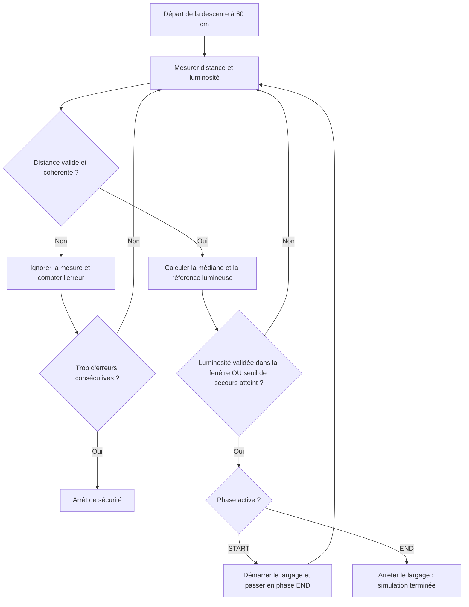

# R.A.L.F. — Analyse des simulations à trois repères

**Campagnes de 50 000 descentes standard et 50 000 descentes stress.**  
**Sources :** `standard_50k.csv`, `stress_50k.csv` et leurs fichiers `.summary.json`, transmis le 11 novembre 2026.  
**Algorithme testé :** la classe `Intelligence` de `intelligence.py` chargée avec des capteurs et actionneurs simulés par `simulation.py`.

> **Résultat principal.** Sur 50 000 missions par profil :
> - **Standard :** 49 996 missions terminées (99,992 %) ; 49 993 ont leurs trois actions à ±1 cm (99,986 % de toutes les simulations).
> - **Stress :** 48 871 missions terminées (97,742 %) ; 46 950 ont leurs trois actions à ±1 cm (93,900 % de toutes les simulations).
> - Le simulateur possède une **ambiguïté de journalisation** : lors de 58 urgences du profil stress, la fermeture de sécurité est inscrite comme un `end_cm`, alors que le deuxième repère **n'a pas été validé**. Les analyses de phase ci-dessous corrigent cette interprétation en rejouant les seeds et les événements moteur/trappe.

## 1. Méthode et contrôles d'intégrité

Les deux CSV contiennent chacun **50 000 lignes**, une par seed, de `0` à `49 999`, sans doublon. Ils ont été comparés intégralement aux statistiques JSON : les effectifs `OK`/`EMERGENCY`, les nombres de missions à ±1 cm, à ±2 cm et sur les rubans concordent.

- `status=OK` : `run_intelligence()` est arrivé jusqu'à l'action finale et a renvoyé `True`. Une mission terminée n'est pas nécessairement précise.
- `status=EMERGENCY` : arrêt de sécurité. Il s'agit d'un **échec de mission**, même si le robot s'immobilise correctement.
- `start_cm`, `end_cm`, `stop_cm` : hauteurs réelles du **modèle**, non les mesures brutes du capteur. Attention à `end_cm` lors d'une urgence, voir §5.
- `*_error_cm = hauteur de l'action - hauteur cible` : erreur positive = action effectuée **avant** d'atteindre la cible pendant la descente ; erreur négative = **après** la cible.
- Les bornes ±1 cm, ±2 cm et ±0,6 cm sont **incluses**. Le critère global exige trois actions correctement positionnées **et** une mission `OK`.
- Tous les pourcentages globaux du résumé prennent **50 000 simulations** pour dénominateur. Les résultats conditionnels aux missions terminées sont indiqués explicitement.

### Configuration commune

| Paramètre | Valeur |
|---|---:|
| Départ | 60 cm |
| Premier scotch noir : ouverture | 20 cm |
| Deuxième scotch noir : fermeture | 10 cm |
| Troisième scotch : arrêt | 5 cm |
| Puissances PWM (avant / pendant / après) | 100 / 100 / 100 % |
| Vitesse **supposée** à 100 % PWM | 2 cm/s |
| Intervalle entre deux lectures | 0,05 s |
| Demi-largeur de chaque ruban | 0,6 cm |
| Luminosité câble / ruban noir / dernier ruban | 60 / 20 / 90 % |
| Dernier ruban simulé | `bright`, donc plus clair que le câble |
| Détection de fin de parcours | `CONTRAST_OR_DISTANCE` |
| Seuil de baisse du noir / contraste final | 30 % / 20 % |
| Nombre de mesures ultrasoniques pour médiane | 3 |
| Confirmation lumineuse | 2 lectures |
| Limite d'erreurs de lecture consécutives | 8 |
| Limite de changement de médiane | jusqu'à 4 cm |
| Durée maximale d'une mission | 120 s |

Les valeurs sont celles des JSON transmis. Les deux campagnes utilisent les **mêmes seeds numériques**, mais des paramètres de bruit différents. Une seed commune ne signifie pas exactement les mêmes événements de capteur.

### Perturbations simulées

| Perturbation | Standard | Stress |
|---|---:|---:|
| Écart-type du bruit ultrasonique | 0,25 cm | 0,50 cm |
| Probabilité de mesure ultrasonique aberrante | 0,5 % | 10 % |
| Probabilité d'absence d'écho | 1 % | 10 % |
| Écart-type du bruit lumineux | 1 point de % | 2 points de % |
| Probabilité de mesure lumineuse aberrante | 0,5 % | 10 % |

Ces événements sont générés de façon aléatoire à chaque lecture. Le modèle ne représente ni une panne persistante, ni l'inertie, ni la pente variable, ni le glissement de la roue, ni la dynamique réelle de la trappe et du freinage.

## 2. Résultats globaux recalculés depuis les CSV

| Indicateur (dénominateur : 50 000) | Standard | Stress |
|---|---:|---:|
| Missions terminées `OK` | **49 996 (99,992 %)** | **48 871 (97,742 %)** |
| Arrêts d'urgence | **4 (0,008 %)** | **1 129 (2,258 %)** |
| Mission `OK` et **trois actions à ±1 cm** | **49 993 (99,986 %)** | **46 950 (93,900 %)** |
| Mission `OK` et **trois actions à ±2 cm** | **49 996 (99,992 %)** | **48 862 (97,724 %)** |
| Mission `OK` et **trois actions sur leurs rubans** (±0,6 cm) | **48 037 (96,074 %)** | **37 870 (75,740 %)** |

La tolérance **±2 cm** inclut des actions ayant lieu **hors du scotch**, puisque sa demi-largeur vaut 0,6 cm. La colonne « sur leurs rubans » indique uniquement une **position géométrique simulée**, pas la certitude que la détection s'est faite optiquement.

### Dénominateur alternatif : missions terminées uniquement

| Critère | Standard (49 996 `OK`) | Stress (48 871 `OK`) |
|---|---:|---:|
| Trois actions à ±1 cm | 49 993 / 49 996 = **99,994 %** | 46 950 / 48 871 = **96,069 %** |
| Trois actions à ±2 cm | 49 996 / 49 996 = **100 %** | 48 862 / 48 871 = **99,982 %** |
| Trois actions sur les rubans | 48 037 / 49 996 = **96,082 %** | 37 870 / 48 871 = **77,490 %** |

Il ne faut pas utiliser ces derniers pourcentages en masquant les urgences. Le taux de missions **totalement conformes à ±1 cm** reste 99,986 % en standard et 93,900 % en stress.

## 3. Précision de chaque action parmi les missions `OK`

| Action | ±1 cm standard | ±1 cm stress | Sur ruban standard | Sur ruban stress |
|---|---:|---:|---:|---:|
| Début du largage (20 cm) | 49 996 | 48 675 | 49 995 | 48 080 |
| Fin du largage (10 cm) | 49 996 | 48 576 | 49 994 | 47 827 |
| Arrêt (5 cm) | 49 993 | 47 424 | 48 040 | 39 360 |

Les écarts globaux ne s'obtiennent pas en additionnant les erreurs individuelles : une même mission peut rater plusieurs repères.

### Extrêmes relevés parmi les missions terminées

| Action | Standard : erreur min → max | Stress : erreur min → max |
|---|---:|---:|
| Début du largage | −0,3 à +0,8 cm | **−1,8 à +2,3 cm** |
| Fin du largage | −0,6 à +1,0 cm | **−1,9 à +2,6 cm** |
| Arrêt final | −0,4 à +1,2 cm | **−1,4 à +2,4 cm** |

La position de l'arrêt final reste la plus difficile à placer sur son ruban. En stress, **9 511 des 48 871 missions terminées** s'immobilisent hors de la largeur simulée du troisième ruban, contre 791 pour le premier et 1 044 pour le deuxième.

**Bilan des écarts** :

- Standard : 3 missions `OK` hors ±1 cm, **aucune** mission `OK` hors ±2 cm. Les 3 écarts à ±1 cm concernent le troisième repère.
- Stress : 1 921 missions `OK` hors ±1 cm et **9** missions `OK` hors ±2 cm.
- Parmi les 1 921 missions stress hors ±1 cm, 1 431 ont un problème **uniquement sur l'arrêt final**. Les autres concernent un ou plusieurs repères.
- En standard, 1 956 missions sont précises à ±1 cm mais n'ont pas leurs trois actions sur les rubans. En stress, ce nombre est 9 080. La différence entre « précision ±1 cm » et « ruban de ±0,6 cm » est donc décisive.

### Les 9 missions terminées hors ±2 cm (stress)

| Seed | Écart début | Écart fin | Écart arrêt | Repère responsable |
|---:|---:|---:|---:|---|
| `22904` | +0,2 | **+2,2** | +0,3 | Fermeture trop tôt |
| `29261` | **+2,3** | 0,0 | +0,3 | Ouverture trop tôt |
| `35866` | +0,4 | +0,4 | **+2,2** | Arrêt trop tôt |
| `38592` | +0,5 | **+2,6** | +0,4 | Fermeture trop tôt |
| `38942` | +0,3 | +0,2 | **+2,2** | Arrêt trop tôt |
| `43771` | +0,3 | −0,7 | **+2,2** | Arrêt trop tôt |
| `43798` | +1,6 | +0,1 | **+2,4** | Arrêt trop tôt |
| `48290` | +0,5 | +0,5 | **+2,1** | Arrêt trop tôt |
| `48346` | +0,9 | +0,5 | **+2,2** | Arrêt trop tôt |

Pour `38592`, le rejeu confirme une **fermeture réelle** à 12,6 cm au lieu de 10 cm, puis un arrêt à 5,4 cm avec `status=OK`. Un retour `OK` seul ne garantit donc pas une distribution dans la zone cible.

## 4. Analyse des arrêts d'urgence

Les urgences des deux profils ont été rejouées, en conservant la même seed et la même configuration, puis en vérifiant la **chronologie des commandes moteur et trappe**. Cette étape distingue la vraie fermeture au deuxième repère de celle exécutée par le bloc `finally` lors d'une urgence.

| Phase de l'urgence | Standard | Stress |
|---|---:|---:|
| Avant le premier repère (trappe jamais ouverte) | 4 | **909** |
| Après ouverture, avant fermeture normale | 0 | **58** |
| Après fermeture normale, avant arrêt final | 0 | **162** |
| **Total** | **4** | **1 129** |

### Origine des arrêts enregistrée lors du rejeu

| Motif logiciel | Standard | Stress |
|---|---:|---:|
| Variations ultrasoniques jugées incohérentes | **4** | **529** |
| Lectures ultrasoniques invalides consécutives | 0 | **600** |
| Dépassement du délai de 120 s | 0 | 0 |

**Répartition détaillée pour le profil stress :** avant le début, 526 arrêts pour variation incohérente et 383 pour valeurs invalides ; pendant le largage, 1 et 57 ; après sa fermeture, 2 et 160.

En standard, les 4 urgences (`576`, `9160`, `10315`, `39162`) arrivent avant la zone de largage, entre 57,4 et 57,5 cm de hauteur. Elles sont dues au filtre de variation des distances, sans perte d'écho enregistrée dans ces quatre cas.

## 5. Défaut identifié dans le journal CSV : `end_cm` lors d'une urgence

**Point de vigilance majeur.** Dans le `simulation.py` fourni, le code cherche la première commande `trap=0` après une ouverture pour définir `end_cm`. Or le bloc `finally` de `run_intelligence()` ferme lui aussi la trappe en cas d'urgence. Il en résulte :

- **58 lignes stress** avec `status=EMERGENCY` comportent un `end_cm` de **fermeture de sécurité**, alors que la logique n'avait **pas encore validé le deuxième scotch**.
- **162 autres lignes stress** en urgence ont effectivement passé le deuxième repère avant l'arrêt : leur premier `end_cm` représente bien la fermeture normale.
- Parmi les lignes stress, **29** affichent `end_cm > 12 cm` (plus de 2 cm avant la cible de 10 cm) : **27** sont des fermetures d'urgence mal étiquetées et **2** sont de véritables fermetures précoces dans des missions `OK` (seeds `22904`, `38592`).
- Exemple : la seed stress `41327` ouvre la trappe à 20,5 cm puis s'arrête en urgence à 18,7 cm. Le CSV affiche `end_cm=18,7`, mais il s'agit **uniquement de la fermeture de sécurité**. L'interpréter comme une détection prématurée du deuxième scotch serait faux.

Les totaux des JSON restent corrects car les critères « trois actions précises » ne comptent **que** les lignes `OK`, et une urgence ne comporte pas de `stop_cm` validé. **Le défaut touche le diagnostic événementiel des lignes d'urgence**, pas les taux globaux affichés plus haut.

**Correction à prévoir dans `simulation.py` :** distinguer explicitement les événements `DEBUT_LARGAGE`, `FIN_LARGAGE`, `ARRET_FINAL` et `FERMETURE_SECURITE`, ou vérifier la phase logicielle avant de renseigner `end_cm`. Ne pas se fonder uniquement sur un ordre `trap=0` pour identifier le deuxième repère. Aucun CSV d'origine n'a été modifié pour produire le présent rapport.

## 6. Ce qu'on peut conclure, et ce qu'on ne peut pas conclure

1. **Le fonctionnement séquentiel est confirmé dans ce modèle.** Toutes les missions `OK` présentent l'ordre ouverture → fermeture → arrêt. Les changements de vitesse sont prévus par l'intelligence, mais les deux campagnes ont configuré **100/100/100 %**. Elles **ne testent donc pas** les performances de trois puissances différentes.
2. **La robustesse diminue avec le bruit.** Les missions terminées passent de 99,992 % à 97,742 % et les missions à trois actions dans ±1 cm passent de 99,986 % à 93,900 %. Les deux profils diffèrent sur plusieurs paramètres simultanément : aucun défaut isolé ne peut être attribué quantitativement à un unique bruit.
3. **L'immobilisation sur le troisième ruban est le principal point faible de précision.** Le taux « sur les trois rubans » descend à 75,740 % sous stress, surtout à cause des déclenchements d'arrêt hors de la largeur de ±0,6 cm.
4. **Le contraste final reste hypothétique.** Le BOSCARD ne fixe pas la couleur du troisième repère. Le simulateur utilise arbitrairement un ruban **clair à 90 %** et un câble à 60 %. Le capteur de luminosité actuel mesure une variation, **pas une couleur identifiable**.
5. **La physique réelle n'est pas validée.** La vitesse est supposée linéaire avec la commande PWM (2 cm/s à 100 %) et l'arrêt est instantané. Un câble incliné, l'inertie, le freinage, les délais de trappe ou une variation d'éclairage peuvent changer les résultats.
6. **Les pourcentages sont des résultats de simulation, pas une garantie de terrain.** Même 50 000 seeds ne prouvent pas l'absence de situations non couvertes par le modèle.

### Priorités après cette campagne

- **P1 :** corriger la journalisation des fermetures de sécurité dans `simulation.py`, puis rejouer les seeds d'urgence.
- **P1 :** contrôler les deux fermetures réellement trop précoces (`22904`, `38592`) et les écarts d'arrêt (`43798`, `35866`, etc.).
- **P2 :** comparer `DISTANCE_ONLY` et `CONTRAST_OR_DISTANCE`, sans modifier simultanément les autres paramètres.
- **P2 :** refaire des campagnes avec un troisième repère sombre (`--final-marker dark`) ou absent (`--final-marker none`) ; le critère « sur ruban » n'est pas applicable si aucun troisième ruban n'existe.
- **P2 :** mesurer sur le robot la vitesse réelle selon le PWM (avant / pendant / après) puis remplacer l'hypothèse de vitesse utilisée par le simulateur.
- **P3 :** tester des pannes prolongées et une inertie réelle, absentes des deux profils aléatoires.

## 7. Commandes pour reproduire et poursuivre les essais

Depuis la racine du projet, avec Python 3.11+ et le `simulation.py`, le `intelligence.py` et le `settings.toml` du patch à trois repères :

```powershell
python -m unittest discover -s tests -v
python simulation.py --count 50000 --seed 0 --profile standard --output results/standard_50k.csv
python simulation.py --count 50000 --seed 0 --profile stress --output results/stress_50k.csv
```

Pour examiner les cas importants (ne pas écraser les CSV de 50 000 lignes) :

```powershell
python simulation.py --count 1 --seed 576 --profile standard --verbose --output results/replay_576.csv
python simulation.py --count 1 --seed 38592 --profile stress --verbose --output results/replay_38592.csv
python simulation.py --count 1 --seed 41327 --profile stress --verbose --output results/replay_41327.csv
python simulation.py --count 1 --seed 43798 --profile stress --verbose --output results/replay_43798.csv
```

Chaque CSV possède un fichier compagnon `.summary.json`, qui conserve **tous les réglages** de sa campagne. Avant de comparer deux versions du code, conserver le SHA GitHub ou une copie locale de `intelligence.py`, `simulation.py` et `settings.toml`, car le résumé JSON n'enregistre pas leurs empreintes cryptographiques.

---

## 8. Historique à deux repères

Les résultats de `logs(7).txt` (**200 000 missions, 99,9155 % à ±1 cm et 100 % à ±2 cm sur START et END**) sont conservés ci-dessous **uniquement à titre d'archive**. Ils reposent sur un **autre simulateur**, une logique limitée à **deux repères** et des hypothèses de mouvement différentes. Ils ne valident pas l'arrêt au troisième repère et **ne sont pas comparables directement** aux campagnes à 50 000 descentes.

---

### Rapport historique à deux repères

**Archive historique : algorithme à deux repères, avant le patch des trois scotchs.**

| Projet | Programme | Campagne analysée | Date | Statut |
|:--|:--|:--|:--|:--|
| **R.A.L.F.** — Robot Autonome de Largage Forestier | ancien `simulation.py` | **`logs(7).txt`** | 24 octobre 2026 | **Validation informatique** |

> [!IMPORTANT]
> **Bilan historique :** la version à deux repères a terminé **200 000 simulations sur 200 000**, avec **99,9155 %** des essais respectant une précision de **±1 cm sur START et END**, et **100 %** respectant **±2 cm**. **Aucun END prématuré vers 20 cm** n'a été observé, confirmant sur un échantillon plus large la correction introduite dans `logs(6).txt`.
>
> Ces chiffres décrivent exclusivement les conditions **simulées** : ils ne garantissent pas la même fiabilité sur le robot réel.

## Chiffres clés

| **200 000 / 200 000** | **99,9155 %** | **100 %** | **99,7185 %** |
|:--:|:--:|:--:|:--:|
| Descentes terminées | START **et** END à ±1 cm | START **et** END à ±2 cm | START **et** END sur leur scotch |

| **169** | **0** | **+0,54 cm** | **5 → 0** |
|:--:|:--:|:--:|:--:|
| Simulations hors ±1 cm | Arrêt pour capteur défaillant | Avance moyenne sur chaque cible | END gravement prématurés, avant/après correction |

---

## Sommaire

1. [Objectif du simulateur](#1-objectif-du-simulateur)
2. [Fonctionnement de la simulation](#2-fonctionnement-de-la-simulation)
3. [Configuration de la campagne](#3-configuration-de-la-campagne)
4. [Résultats détaillés de `logs(7).txt`](#4-résultats-détaillés-de-logs7txt)
5. [Analyse des 169 écarts à ±1 cm](#5-analyse-des-169-écarts-à-1-cm)
6. [Comparaison avec la version précédente](#6-comparaison-avec-la-version-précédente)
7. [Limites et essais à réaliser](#7-limites-et-essais-à-réaliser)
8. [Conclusion](#8-conclusion)

---

## 1. Objectif du simulateur

L'**ancienne version de `simulation.py`** servait à tester les deux premiers repères **sur ordinateur, sans déplacer le robot réel**. Il permet d'exécuter des milliers de descentes, de provoquer des erreurs de capteurs et de mesurer précisément à quelle hauteur les deux actions sont déclenchées.

### Les deux actions vérifiées

| Action | Hauteur cible | Comportement attendu |
|:--|--:|:--|
| **START** | **20 cm** | Début du largage de graines |
| **END** | **10 cm** | Fin du largage de graines |

### Ce que le simulateur reproduit

- **Descente du robot :** départ à 60 cm, puis progression de **0,2 cm à chaque nouvelle lecture de hauteur**.
- **Capteur ultrasonique :** mesures arrondies au centimètre, bruit, mesures aberrantes et pertes d'écho (`-1`).
- **Capteur lumineux :** câble gris, deux scotchs noirs, bruit et fausses lectures.
- **Logique de l'intelligence :** médiane des distances, référence lumineuse, confirmation des lectures sombres et distance de secours.
- **Tests reproductibles :** chaque descente possède une **seed** (graine aléatoire) permettant de retrouver les mêmes erreurs.

**Intérêt principal :** déceler des situations problématiques avant de tester le robot physique, et comparer deux versions du programme dans **les mêmes conditions**.

## 2. Fonctionnement de la simulation

### Chaîne de décision



Le déclenchement lumineux n'est autorisé que dans la fenêtre de hauteur prévue et après **deux lectures sombres consécutives**. Si cette détection ne fonctionne pas, le **seuil ultrasonique de secours** peut déclencher l'action. Les deux conditions peuvent être vraies simultanément.

### Comment lire le journal ?

Le fichier de résultats commence par une ligne `CONFIG;...`, puis enregistre la *seed* de chaque descente et **deux lignes CSV** (une pour START, une pour END).

```text
Simulation des capteurs : descente de 60 cm a 0 cm avec seed : 0
START,20.60,20,21,35.00,60.10,0,1,20
END,10.60,10,11,34.86,58.13,0,1,10
```

| Colonne | Contenu | Exemple START |
|:--:|:--|--:|
| 1 | Phase | `START` |
| 2 | Hauteur réelle simulée (cm) | `20.60` |
| 3 | Hauteur brute mesurée (cm) | `20` |
| 4 | Médiane ultrasonique (cm) | `21` |
| 5 | Luminosité mesurée (%) | `35.00` |
| 6 | Luminosité de référence (%) | `60.10` |
| 7 | Condition de distance (`0` = non, `1` = oui) | `0` |
| 8 | Condition lumineuse (`0` = non, `1` = oui) | `1` |
| 9 | Hauteur cible (cm) | `20` |

> [!NOTE]
> La hauteur **réelle simulée** est utilisée pour évaluer la précision. La médiane est la valeur **estimée par le programme**, qui peut être différente à cause du bruit, de l'arrondi et du filtrage.

---

## 3. Configuration de la campagne

**Source :** en-tête `CONFIG` de `logs(7).txt`. Les paramètres ci-dessous décrivent la campagne étudiée, et non nécessairement les valeurs les plus adaptées aux essais réels.

### 3.1. Conditions simulées

| Paramètre | Valeur | Signification |
|:--|--:|:--|
| Nombre de simulations | **200 000** | *Seeds* de `0` à `199 999` |
| `INITIAL_HEIGHT_CM` | 60 cm | Position de départ |
| `DESCENT_CM_PER_READING` | 0,2 cm | Déplacement par lecture de hauteur |
| `START_MARKER_CM` | 20 cm | Centre du premier scotch |
| `END_MARKER_CM` | 10 cm | Centre du second scotch |
| `MARKER_HALF_WIDTH_CM` | ±0,9 cm | Zone occupée par chaque scotch |
| `NORMAL_BRIGHTNESS` | 60 % | Valeur du câble gris |
| `MARKER_BRIGHTNESS` | 35 % | Valeur des scotchs noirs |
| `BRIGHTNESS_NOISE` | 0,25 point | Écart-type du bruit lumineux |
| `HEIGHT_NOISE_CM` | 0,25 cm | Écart-type du bruit de distance |
| `HEIGHT_FALSE_READING_RATE` | 2 % | Mesures de distance aberrantes |
| `HEIGHT_NO_ECHO_RATE` | 2 % | Absences d'écho (`-1`) |
| `BRIGHTNESS_FALSE_READING_RATE` | 3 % | Mesures lumineuses aberrantes |
| `RANDOM_SEED` | 0 | Début de la plage de graines aléatoires |
| `PRINT_EACH_SIMULATION` | `True` | Journal détaillé activé |

### 3.2. Réglages de l'intelligence

| Paramètre | Valeur | Utilité |
|:--|--:|:--|
| `START_PROPAGATION_HEIGHT` | 20 cm | Cible START |
| `END_PROPAGATION_HEIGHT` | 10 cm | Cible END |
| `SECURITY_LEEWAY` | **1 cm** | Secours si médiane ≤ 19 cm (START) ou ≤ 9 cm (END) |
| `BRIGHTNESS_DETECTION_WINDOW` | **±1 cm** | Fenêtre dans laquelle la lumière peut déclencher |
| `BRIGHTNESS_DROP_DETECTION` | 30 % | Baisse requise par rapport à la référence |
| `DISTANCE_SAMPLES` | 3 | Mesures de la médiane ultrasonique |
| `BRIGHTNESS_SAMPLES` | 20 | Taille maximale de la fenêtre de moyenne lumineuse |
| `MIN_BRIGHTNESS_SAMPLES` | 5 | Échantillons minimum pour la référence lumineuse |
| `BRIGHTNESS_CONFIRM_SAMPLES` | 2 | Lectures sombres consécutives requises |
| `MAX_HEIGHT_CHANGE_CM_PER_READING` | 2 cm | Seuil de cohérence des changements de médiane |
| `MAX_INVALID_READINGS` | 8 | Limite avant arrêt de sécurité |

### Critères de réussite

La précision est évaluée par rapport à la **hauteur réelle simulée**, avec les bornes **incluses** :

| Critère | START valide | END valide |
|:--|:--|:--|
| **±1 cm** | 19 à 21 cm | 9 à 11 cm |
| **±2 cm** | 18 à 22 cm | 8 à 12 cm |
| **Sur le scotch** | 19,1 à 20,9 cm | 9,1 à 10,9 cm |

Une simulation n'est comptée comme **globalement réussie** que si **START et END** respectent tous les deux le critère considéré.

---

## 4. Résultats détaillés de `logs(7).txt`

### 4.1. Fiabilité globale

| Indicateur | Cas conformes | Résultat |
|:--|--:|--:|
| Exécution des deux actions | 200 000 / 200 000 | **100 %** |
| START et END à ±1 cm | 199 831 / 200 000 | **99,9155 %** |
| START et END à ±2 cm | 200 000 / 200 000 | **100 %** |
| START et END sur leur scotch | 199 437 / 200 000 | **99,7185 %** |
| Arrêts par capteur défaillant | 0 / 200 000 | **0 %** |

> [!IMPORTANT]
> **100 % à ±2 cm** signifie qu'aucun échec n'a été constaté *dans ces 200 000 tests*. Cela ne garantit pas un taux d'échec nul sur le robot réel ni dans toutes les conditions possibles.

### 4.2. Précision des déclenchements

| Mesure | START — cible 20 cm | END — cible 10 cm |
|:--|--:|--:|
| **Hauteur moyenne** | **20,543 cm** | **10,543 cm** |
| Hauteur médiane | 20,6 cm | 10,6 cm |
| Écart-type | 0,191 cm | 0,191 cm |
| Hauteur minimale | 18,4 cm | 8,4 cm |
| Hauteur maximale | 21,6 cm | 11,6 cm |
| **Dans ±1 cm** | **199 921 (99,9605 %)** | **199 910 (99,9550 %)** |
| Sur le scotch | 199 736 (99,8680 %) | 199 701 (99,8505 %) |

**Interprétation.** Les actions surviennent en moyenne **0,54 cm avant leurs hauteurs cibles**. Comme le robot descend, cela correspond généralement à la **première partie du scotch noir**, et non à son centre : ce décalage n'est donc pas nécessairement un défaut.

### 4.3. Conditions qui ont déclenché les actions

| Condition validée | START | END | Total |
|:--|--:|--:|--:|
| Luminosité | 199 735 | 199 719 | **399 454** |
| Distance de secours | 509 | 525 | **1 034** |
| Luminosité **et** distance | 244 | 244 | **488** |

Les lignes **ne doivent pas être additionnées** : dans **488 actions**, la condition lumineuse et le seuil de distance sont vrais en même temps. La détection lumineuse est validée sur **99,8635 % des 400 000 actions** ; **546 actions** ont été déclenchées uniquement par le secours ultrasonique.

---

## 5. Analyse des 169 écarts à ±1 cm

Parmi les **200 000 descentes**, **169** présentent au moins une action dépassant l'erreur admissible de **±1 cm**. Aucun de ces écarts ne dépasse **±2 cm**.

| Nature de l'écart | START | END | Total |
|:--|--:|--:|--:|
| **Trop tôt** : déclenchement lumineux | 52 | 51 | **103** |
| **Trop tard** : secours par distance | 27 | 39 | **66** |
| **Total** | **79** | **90** | **169** |

### Cas extrêmes

| Action | Hauteurs extrêmes observées | Écart maximal à la cible |
|:--|:--|:--|
| START | **18,4 à 21,6 cm** | **±1,6 cm** |
| END | **8,4 à 11,6 cm** | **±1,6 cm** |

**Pourquoi ces erreurs subsistent-elles ?**

- **Trop tôt :** une fausse lecture sombre peut être confirmée alors que le robot se trouve encore dans la fenêtre lumineuse autorisée.
- **Trop tard :** la médiane ultrasonique est parfois en retard sur la position réelle ; le secours se déclenche seulement lorsque cette médiane atteint son seuil.

**Point à retenir :** la marge `SECURITY_LEEWAY = 1` fixe un seuil pour la **mesure filtrée** ; elle ne garantit pas que l'erreur **réelle** restera inférieure ou égale à 1 cm. La campagne plus longue révèle également des erreurs atteignant **1,6 cm**, mais aucune supérieure à **2 cm**.

---

## 6. Comparaison avec les campagnes précédentes

### Le problème corrigé

Dans `logs(5).txt`, **5 simulations** déclenchaient END autour de **20 cm**, presque immédiatement après START, alors que la fin du largage devait se produire vers **10 cm**.

**Cause identifiée :** le programme réinitialisait `last_median_height` après START. Sans cette dernière hauteur fiable, la vérification des changements brusques pouvait laisser passer deux mesures ultrasoniques aberrantes successives juste après le changement de phase.

**Correction :** conserver `last_median_height` pendant le passage de START à END, tout en réinitialisant les historiques et compteurs qui doivent l'être.

```python
# Passage de START à END
# Conserver last_median_height : elle sert de référence de cohérence.

distance_history.clear()
brightness_history.clear()
brightness_reference = None
consecutive_invalid = 0
brightness_confirmations = 0
```

### Résultats avant / après, puis validation élargie

| Indicateur | Avant — `logs(5).txt` (50k) | Corrigé — `logs(6).txt` (50k) | Validation — `logs(7).txt` (200k) |
|:--|--:|--:|--:|
| Deux actions à ±1 cm | 99,902 % | 99,912 % | **99,9155 %** |
| Deux actions à ±2 cm | 99,990 % | 100 % | **100 %** |
| Deux actions sur leur scotch | 99,714 % | 99,724 % | **99,7185 %** |
| END vers 20 cm | **5** | **0** | **0** |
| Arrêts pour capteur défaillant | 0 | 0 | **0** |

> [!NOTE]
> Les **50 000 premières seeds** de `logs(7).txt` produisent **exactement les mêmes 100 000 lignes de déclenchement** que `logs(6).txt`. La campagne élargie confirme donc le comportement corrigé sur **150 000 seeds supplémentaires** ; ce n'est pas une nouvelle modification de l'algorithme.

### Les cinq simulations réparées

| Seed | END avant | END après | Résultat |
|--:|--:|--:|:--|
| `10750` | 19,8 cm | **10,6 cm** | Corrigé |
| `24769` | 20,0 cm | **10,6 cm** | Corrigé |
| `34362` | 20,2 cm | **10,6 cm** | Corrigé |
| `35783` | 20,0 cm | **10,6 cm** | Corrigé |
| `36883` | 20,0 cm | **10,6 cm** | Corrigé |

La correction supprime le problème des **END immédiatement après START** dans les campagnes corrigées analysées. Le passage de 50 000 à 200 000 essais permet surtout d'observer davantage de cas rares, sans révéler de nouvelle erreur supérieure à ±2 cm.

---

## 7. Limites et essais à réaliser

### Ce que ces simulations ne valident pas encore

| Limite | Conséquence possible sur R.A.L.F. |
|:--|:--|
| **Vitesse réelle et fréquence des lectures** | Le robot peut avancer davantage que 0,2 cm entre deux décisions. |
| **Inertie et temps de réponse** | Le déplacement peut continuer après l'ordre d'arrêt ; la trappe n'agit pas instantanément. |
| **Éclairage, vibrations, orientation** | Les mesures lumineuses et ultrasoniques peuvent différer du modèle. |
| **Erreurs corrélées ou persistantes** | Certaines pannes réelles ne correspondent pas aux probabilités simulées. |
| **Placement et largeur réels des scotchs** | Les zones effectives de détection peuvent se décaler. |

### Plan d'essais physiques recommandé

- [ ] **Mesurer** la vitesse de descente et l'intervalle réel entre deux lectures.
- [ ] **Contrôler** les hauteurs de START et END sur plusieurs descentes.
- [ ] **Tester** avec différentes conditions d'éclairage et d'orientation des capteurs.
- [ ] **Mesurer** le délai d'ouverture et de fermeture du système de largage.
- [ ] **Rejouer** les seeds problématiques en simulation après chaque modification du code.
- [ ] **Conserver** `logs(7).txt` comme nouvelle référence de validation, et `logs(6).txt` comme point de comparaison à 50 000 simulations.

---

## 8. Conclusion

> [!TIP]
> **Décision recommandée : passer aux essais physiques contrôlés.**
>
> La version analysée est **robuste dans le modèle simulé** : 200 000 descentes terminées, **99,9155 %** des essais avec START et END à **±1 cm**, **100 %** à **±2 cm** et **aucun déclenchement END gravement prématuré**. Cette campagne élargie confirme l'intérêt de la correction appliquée après `logs(5).txt`.
>
> La prochaine amélioration utile ne consiste pas forcément à modifier les seuils : elle consiste surtout à **mesurer le comportement du robot réel** et à confronter ces mesures aux hypothèses de `simulation.py`.

---

<sub>**Traçabilité —** Sources : ancienne version de `simulation.py` (modèle et logique simulée), `logs(7).txt` (200 000 tests avec la correction), `logs(6).txt` (50 000 tests avec la correction), `logs(5).txt` (50 000 tests avant correction). Statistiques vérifiées à partir des lignes individuelles des journaux. Les bornes des intervalles sont incluses.</sub>
