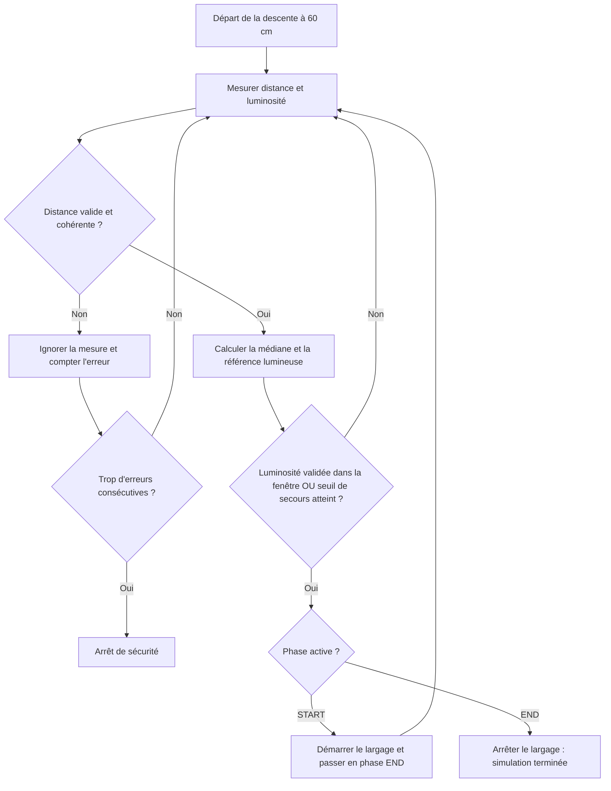

# R.A.L.F. — Rapport de simulation

**Validation de l'intelligence de détection et de largage**

| Projet | Programme | Campagne analysée | Date | Statut |
|:--|:--|:--|:--|:--|
| **R.A.L.F.** — Robot Autonome de Largage Forestier | `simulation.py` | **`logs.txt`** | 24 octobre 2026 | **Validation informatique** |

> [!IMPORTANT]
> **Bilan :** la dernière version a terminé **200 000 simulations sur 200 000**, avec **99,9155 %** des essais respectant une précision de **±1 cm sur START et END**, et **100 %** respectant **±2 cm**. **Aucun END prématuré vers 20 cm** n'a été observé, confirmant sur un échantillon plus large la correction introduite antérieurement.
>
> Ces chiffres décrivent exclusivement les conditions **simulées** : ils ne garantissent pas la même fiabilité sur le robot réel.

## Chiffres clés

| **200 000 / 200 000** | **99,9155 %** | **100 %** | **99,7185 %** |
|:--:|:--:|:--:|:--:|
| Descentes terminées | START **et** END à ±1 cm | START **et** END à ±2 cm | START **et** END sur leur scotch |

| **169** | **0** | **+0,54 cm** | **5 → 0** |
|:--:|:--:|:--:|:--:|
| Simulations hors ±1 cm | Arrêt pour capteur défaillant | Avance moyenne sur chaque cible | END gravement prématurés, avant/après correction |

---

## Sommaire

1. [Objectif du simulateur](#1-objectif-du-simulateur)
2. [Fonctionnement de la simulation](#2-fonctionnement-de-la-simulation)
3. [Configuration de la campagne](#3-configuration-de-la-campagne)
4. [Résultats détaillés de `logs.txt`](#4-résultats-détaillés-de-logs7txt)
5. [Analyse des 169 écarts à ±1 cm](#5-analyse-des-169-écarts-à-1-cm)
6. [Comparaison avec la version précédente](#6-comparaison-avec-la-version-précédente)
7. [Limites et essais à réaliser](#7-limites-et-essais-à-réaliser)
8. [Conclusion](#8-conclusion)

---

## 1. Objectif du simulateur

Le fichier **`simulation.py`** sert à tester l'intelligence de R.A.L.F. **sur ordinateur, sans déplacer le robot réel**. Il permet d'exécuter des milliers de descentes, de provoquer des erreurs de capteurs et de mesurer précisément à quelle hauteur les deux actions sont déclenchées.

### Les deux actions vérifiées

| Action | Hauteur cible | Comportement attendu |
|:--|--:|:--|
| **START** | **20 cm** | Début du largage de graines |
| **END** | **10 cm** | Fin du largage de graines |

### Ce que le simulateur reproduit

- **Descente du robot :** départ à 60 cm, puis progression de **0,2 cm à chaque nouvelle lecture de hauteur**.
- **Capteur ultrasonique :** mesures arrondies au centimètre, bruit, mesures aberrantes et pertes d'écho (`-1`).
- **Capteur lumineux :** câble gris, deux scotchs noirs, bruit et fausses lectures.
- **Logique de l'intelligence :** médiane des distances, référence lumineuse, confirmation des lectures sombres et distance de secours.
- **Tests reproductibles :** chaque descente possède une **seed** (graine aléatoire) permettant de retrouver les mêmes erreurs.

**Intérêt principal :** déceler des situations problématiques avant de tester le robot physique, et comparer deux versions du programme dans **les mêmes conditions**.

## 2. Fonctionnement de la simulation

### Chaîne de décision



Le déclenchement lumineux n'est autorisé que dans la fenêtre de hauteur prévue et après **deux lectures sombres consécutives**. Si cette détection ne fonctionne pas, le **seuil ultrasonique de secours** peut déclencher l'action. Les deux conditions peuvent être vraies simultanément.

### Comment lire le journal ?

Le fichier de résultats commence par une ligne `CONFIG;...`, puis enregistre la *seed* de chaque descente et **deux lignes CSV** (une pour START, une pour END).

```text
Simulation des capteurs : descente de 60 cm a 0 cm avec seed : 0
START,20.60,20,21,35.00,60.10,0,1,20
END,10.60,10,11,34.86,58.13,0,1,10
```

| Colonne | Contenu | Exemple START |
|:--:|:--|--:|
| 1 | Phase | `START` |
| 2 | Hauteur réelle simulée (cm) | `20.60` |
| 3 | Hauteur brute mesurée (cm) | `20` |
| 4 | Médiane ultrasonique (cm) | `21` |
| 5 | Luminosité mesurée (%) | `35.00` |
| 6 | Luminosité de référence (%) | `60.10` |
| 7 | Condition de distance (`0` = non, `1` = oui) | `0` |
| 8 | Condition lumineuse (`0` = non, `1` = oui) | `1` |
| 9 | Hauteur cible (cm) | `20` |

> [!NOTE]
> La hauteur **réelle simulée** est utilisée pour évaluer la précision. La médiane est la valeur **estimée par le programme**, qui peut être différente à cause du bruit, de l'arrondi et du filtrage.

---

## 3. Configuration de la campagne

**Source :** en-tête `CONFIG` de `logs(7).txt`. Les paramètres ci-dessous décrivent la campagne étudiée, et non nécessairement les valeurs les plus adaptées aux essais réels.

### 3.1. Conditions simulées

| Paramètre | Valeur | Signification |
|:--|--:|:--|
| Nombre de simulations | **200 000** | *Seeds* de `0` à `199 999` |
| `INITIAL_HEIGHT_CM` | 60 cm | Position de départ |
| `DESCENT_CM_PER_READING` | 0,2 cm | Déplacement par lecture de hauteur |
| `START_MARKER_CM` | 20 cm | Centre du premier scotch |
| `END_MARKER_CM` | 10 cm | Centre du second scotch |
| `MARKER_HALF_WIDTH_CM` | ±0,9 cm | Zone occupée par chaque scotch |
| `NORMAL_BRIGHTNESS` | 60 % | Valeur du câble gris |
| `MARKER_BRIGHTNESS` | 35 % | Valeur des scotchs noirs |
| `BRIGHTNESS_NOISE` | 0,25 point | Écart-type du bruit lumineux |
| `HEIGHT_NOISE_CM` | 0,25 cm | Écart-type du bruit de distance |
| `HEIGHT_FALSE_READING_RATE` | 2 % | Mesures de distance aberrantes |
| `HEIGHT_NO_ECHO_RATE` | 2 % | Absences d'écho (`-1`) |
| `BRIGHTNESS_FALSE_READING_RATE` | 3 % | Mesures lumineuses aberrantes |
| `RANDOM_SEED` | 0 | Début de la plage de graines aléatoires |
| `PRINT_EACH_SIMULATION` | `True` | Journal détaillé activé |

### 3.2. Réglages de l'intelligence

| Paramètre | Valeur | Utilité |
|:--|--:|:--|
| `START_PROPAGATION_HEIGHT` | 20 cm | Cible START |
| `END_PROPAGATION_HEIGHT` | 10 cm | Cible END |
| `SECURITY_LEEWAY` | **1 cm** | Secours si médiane ≤ 19 cm (START) ou ≤ 9 cm (END) |
| `BRIGHTNESS_DETECTION_WINDOW` | **±1 cm** | Fenêtre dans laquelle la lumière peut déclencher |
| `BRIGHTNESS_DROP_DETECTION` | 30 % | Baisse requise par rapport à la référence |
| `DISTANCE_SAMPLES` | 3 | Mesures de la médiane ultrasonique |
| `BRIGHTNESS_SAMPLES` | 20 | Taille maximale de la fenêtre de moyenne lumineuse |
| `MIN_BRIGHTNESS_SAMPLES` | 5 | Échantillons minimum pour la référence lumineuse |
| `BRIGHTNESS_CONFIRM_SAMPLES` | 2 | Lectures sombres consécutives requises |
| `MAX_HEIGHT_CHANGE_CM_PER_READING` | 2 cm | Seuil de cohérence des changements de médiane |
| `MAX_INVALID_READINGS` | 8 | Limite avant arrêt de sécurité |

### Critères de réussite

La précision est évaluée par rapport à la **hauteur réelle simulée**, avec les bornes **incluses** :

| Critère | START valide | END valide |
|:--|:--|:--|
| **±1 cm** | 19 à 21 cm | 9 à 11 cm |
| **±2 cm** | 18 à 22 cm | 8 à 12 cm |
| **Sur le scotch** | 19,1 à 20,9 cm | 9,1 à 10,9 cm |

Une simulation n'est comptée comme **globalement réussie** que si **START et END** respectent tous les deux le critère considéré.

---

## 4. Résultats détaillés de `logs.txt`

### 4.1. Fiabilité globale

| Indicateur | Cas conformes | Résultat |
|:--|--:|--:|
| Exécution des deux actions | 200 000 / 200 000 | **100 %** |
| START et END à ±1 cm | 199 831 / 200 000 | **99,9155 %** |
| START et END à ±2 cm | 200 000 / 200 000 | **100 %** |
| START et END sur leur scotch | 199 437 / 200 000 | **99,7185 %** |
| Arrêts par capteur défaillant | 0 / 200 000 | **0 %** |

> [!IMPORTANT]
> **100 % à ± 2 cm** signifie qu'aucun échec n'a été constaté *dans ces 200 000 tests*. Cela ne garantit pas un taux d'échec nul sur le robot réel ni dans toutes les conditions possibles.

### 4.2. Précision des déclenchements

| Mesure | START — cible 20 cm | END — cible 10 cm |
|:--|--:|--:|
| **Hauteur moyenne** | **20,543 cm** | **10,543 cm** |
| Hauteur médiane | 20,6 cm | 10,6 cm |
| Écart-type | 0,191 cm | 0,191 cm |
| Hauteur minimale | 18,4 cm | 8,4 cm |
| Hauteur maximale | 21,6 cm | 11,6 cm |
| **Dans ±1 cm** | **199 921 (99,9605 %)** | **199 910 (99,9550 %)** |
| Sur le scotch | 199 736 (99,8680 %) | 199 701 (99,8505 %) |

**Interprétation.** Les actions surviennent en moyenne **0,54 cm avant leurs hauteurs cibles**. Comme le robot descend, cela correspond généralement à la **première partie du scotch noir**, et non à son centre : ce décalage n'est donc pas nécessairement un défaut.

### 4.3. Conditions qui ont déclenché les actions

| Condition validée | START | END | Total |
|:--|--:|--:|--:|
| Luminosité | 199 735 | 199 719 | **399 454** |
| Distance de secours | 509 | 525 | **1 034** |
| Luminosité **et** distance | 244 | 244 | **488** |

Les lignes **ne doivent pas être additionnées** : dans **488 actions**, la condition lumineuse et le seuil de distance sont vrais en même temps. La détection lumineuse est validée sur **99,8635 % des 400 000 actions** ; **546 actions** ont été déclenchées uniquement par le secours ultrasonique.

---

## 5. Analyse des 169 écarts à ± 1 cm

Parmi les **200 000 descentes**, **169** présentent au moins une action dépassant l'erreur admissible de **±1 cm**. Aucun de ces écarts ne dépasse **±2 cm**.

| Nature de l'écart | START | END | Total |
|:--|--:|--:|--:|
| **Trop tôt** : déclenchement lumineux | 52 | 51 | **103** |
| **Trop tard** : secours par distance | 27 | 39 | **66** |
| **Total** | **79** | **90** | **169** |

### Cas extrêmes

| Action | Hauteurs extrêmes observées | Écart maximal à la cible |
|:--|:--|:--|
| START | **18,4 à 21,6 cm** | **±1,6 cm** |
| END | **8,4 à 11,6 cm** | **±1,6 cm** |

**Pourquoi ces erreurs subsistent-elles ?**

- **Trop tôt :** une fausse lecture sombre peut être confirmée alors que le robot se trouve encore dans la fenêtre lumineuse autorisée.
- **Trop tard :** la médiane ultrasonique est parfois en retard sur la position réelle ; le secours se déclenche seulement lorsque cette médiane atteint son seuil.

**Point à retenir :** la marge `SECURITY_LEEWAY = 1` fixe un seuil pour la **mesure filtrée** ; elle ne garantit pas que l'erreur **réelle** restera inférieure ou égale à 1 cm. La campagne plus longue révèle également des erreurs atteignant **1,6 cm**, mais aucune supérieure à **2 cm**.

---

## 6. Comparaison avec les campagnes précédentes

### Le problème corrigé

Précédemment, **5 simulations** déclenchaient END autour de **20 cm**, presque immédiatement après START, alors que la fin du largage devait se produire vers **10 cm**.

**Cause identifiée :** le programme réinitialisait `last_median_height` après START. Sans cette dernière hauteur fiable, la vérification des changements brusques pouvait laisser passer deux mesures ultrasoniques aberrantes successives juste après le changement de phase.

**Correction :** conserver `last_median_height` pendant le passage de START à END, tout en réinitialisant les historiques et compteurs qui doivent l'être.

```python
# Passage de START à END
# Conserver last_median_height : elle sert de référence de cohérence.

distance_history.clear()
brightness_history.clear()
brightness_reference = None
consecutive_invalid = 0
brightness_confirmations = 0
```

### Résultats avant / après, puis validation élargie

| Indicateur | Avant — `logs(5).txt` (50k) | Corrigé — `logs(6).txt` (50k) | Validation — `logs(7).txt` (200k) |
|:--|--:|--:|--:|
| Deux actions à ±1 cm | 99,902 % | 99,912 % | **99,9155 %** |
| Deux actions à ±2 cm | 99,990 % | 100 % | **100 %** |
| Deux actions sur leur scotch | 99,714 % | 99,724 % | **99,7185 %** |
| END vers 20 cm | **5** | **0** | **0** |
| Arrêts pour capteur défaillant | 0 | 0 | **0** |

> [!NOTE]
> Les **50 000 premières seeds** de `logs(7).txt` produisent **exactement les mêmes 100 000 lignes de déclenchement** que `logs(6).txt`. La campagne élargie confirme donc le comportement corrigé sur **150 000 seeds supplémentaires** ; ce n'est pas une nouvelle modification de l'algorithme.

### Les cinq simulations réparées

| Seed | END avant | END après | Résultat |
|--:|--:|--:|:--|
| `10750` | 19,8 cm | **10,6 cm** | Corrigé |
| `24769` | 20,0 cm | **10,6 cm** | Corrigé |
| `34362` | 20,2 cm | **10,6 cm** | Corrigé |
| `35783` | 20,0 cm | **10,6 cm** | Corrigé |
| `36883` | 20,0 cm | **10,6 cm** | Corrigé |

La correction supprime le problème des **END immédiatement après START** dans les campagnes corrigées analysées. Le passage de 50 000 à 200 000 essais permet surtout d'observer davantage de cas rares, sans révéler de nouvelle erreur supérieure à ±2 cm.

---

## 7. Limites et essais à réaliser

### Ce que ces simulations ne valident pas encore

| Limite | Conséquence possible sur R.A.L.F. |
|:--|:--|
| **Vitesse réelle et fréquence des lectures** | Le robot peut avancer davantage que 0,2 cm entre deux décisions. |
| **Inertie et temps de réponse** | Le déplacement peut continuer après l'ordre d'arrêt ; la trappe n'agit pas instantanément. |
| **Éclairage, vibrations, orientation** | Les mesures lumineuses et ultrasoniques peuvent différer du modèle. |
| **Erreurs corrélées ou persistantes** | Certaines pannes réelles ne correspondent pas aux probabilités simulées. |
| **Placement et largeur réels des scotchs** | Les zones effectives de détection peuvent se décaler. |

### Plan d'essais physiques recommandé

- [ ] **Mesurer** la vitesse de descente et l'intervalle réel entre deux lectures.
- [ ] **Contrôler** les hauteurs de START et END sur plusieurs descentes.
- [ ] **Tester** avec différentes conditions d'éclairage et d'orientation des capteurs.
- [ ] **Mesurer** le délai d'ouverture et de fermeture du système de largage.
- [ ] **Rejouer** les seeds problématiques en simulation après chaque modification du code.
- [ ] **Conserver** `logs(7).txt` comme nouvelle référence de validation, et `logs(6).txt` comme point de comparaison à 50 000 simulations.

---

## 8. Conclusion

> [!TIP]
> **Décision recommandée : passer aux essais physiques contrôlés.**
>
> La version analysée est **robuste dans le modèle simulé** : 200 000 descentes terminées, **99,9155 %** des essais avec START et END à **±1 cm**, **100 %** à **±2 cm** et **aucun déclenchement END gravement prématuré**. Cette campagne élargie confirme l'intérêt de la correction appliquée après `logs(5).txt`.
>
> La prochaine amélioration utile ne consiste pas forcément à modifier les seuils : elle consiste surtout à **mesurer le comportement du robot réel** et à confronter ces mesures aux hypothèses de `simulation.py`.

---

<sub>**Traçabilité —** Sources : `simulation.py` (modèle et logique simulée), `logs(7).txt` (200 000 tests avec la correction), `logs(6).txt` (50 000 tests avec la correction), `logs(5).txt` (50 000 tests avant correction). Statistiques vérifiées à partir des lignes individuelles des journaux. Les bornes des intervalles sont incluses.</sub>
